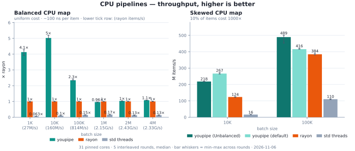
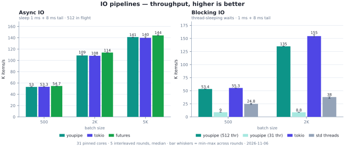
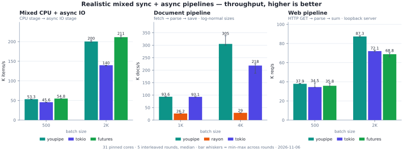

# youpipe

English | [简体中文](https://github.com/lxl66566/youpipe/blob/main/README.zh-CN.md)

youpipe is a parallel pipeline library for Rust. Items enter at the front, stages chain in order, and one terminal call (`.collect()` / `.run()`) executes the whole chain and hands back the result. Three engines cover different scenarios:

- `Pipe`: compile-time fused CPU chains. `.map()` and `.filter()` are composed into a single generic type at compile time and expand into one call at run time, so no intermediate value is produced between map and filter. `.collect()` writes results into a buffer in input order. Closures must be `'static`; use `pipe_ref` or `scope` when local data has to be borrowed.
- `StreamPipe`: stages connected by bounded channels, each stage running on its own worker. Sync and async stages run on the CPU and IO pools respectively. It covers async IO, backpressure, fences, cancellation and 1-to-N expansion, which `Pipe` cannot express. Output arrives in completion order (unordered) by default, and `.ordered()` restores input order.
  - A chain with only plain `.stage()` degrades to `Pipe`: channels and backpressure are elided, and output is in input order.
- `graph()`: a DAG built at run time, with broadcast fan-out and fan-in that round-robins over in-edges. CPU nodes and IO nodes mix freely in one graph. Non-broadcast nodes pass items by move, with no `Clone` bound; broadcast nodes clone. Graph output always arrives in completion order (unordered).

The scheduler is adapted from rayon-core. Every worker owns an `st3` LIFO deque, and idle workers steal from the other end, which suits both balanced and unbalanced loads. `scope()` accepts non-`'static` closures that borrow stack-local data.

## Quick start

Add the dependency: `cargo add youpipe`

`items.pipe()` is sugar for `pipe(items)`.

For the simplest rayon usage (one round of CPU parallelism, as in `data.par_iter().map(|&x| x * 2).collect()`), rewrite it as below for a free small speedup:

```rust
use youpipe::prelude::*;
let r: Vec<i32> = data.pipe_ref().map(|&x| x * 2).collect();  // par_iter -> pipe_ref
```

The other engines:

```rust
use youpipe::prelude::*;

// fused CPU chain: three steps compose into one generic type, no intermediate Vec
let r: Vec<i32> = (0..1000).pipe()
    .map(|x| x + 1)
    .filter(|x: &i32| x % 2 == 0)
    .map(|x| x * 10)
    .collect();

// aggregation terminal: the same fused path, no output Vec allocated
let s: i64 = (0..1000).pipe().map(|x| x + 1).sum();

// a sync stage and an async IO stage overlap on their own pools
let r: Vec<u64> = (0..1000).stream()
    .stage(|x: u64| x + 1)
    .stage_async(|x: u64| async move { fetch(x).await })
    .run();

// runtime DAG: broadcast to two branches, then join them into one node
let mut g = youpipe::graph();
let src = g.source_broadcast("load", 0..1000u64);
let a = g.node("hash", |x: u64| x * 2);
let b = g.node_async("meta", |x: u64| async move { fetch(x).await });
let join = g.node("join", |x: u64| x);
let out = g.sink_collect("out");
g.edge(src, a).edge(src, b).edge(a, join).edge(b, join).edge(join, out);
let union: Vec<u64> = g.run_collect(out);
```

The full manual is at [lxl66566.github.io/youpipe](https://lxl66566.github.io/youpipe/):

- [User guide](https://lxl66566.github.io/youpipe/guide/getting-started.html): fused chains, stream chains, DAGs, borrowing data, error handling
- [Performance tuning](https://lxl66566.github.io/youpipe/advanced/choosing-engine.html): engine choice, workload hints, pools, per-stage knobs, most useful once the workload is known
- [Benchmarks and methodology](https://lxl66566.github.io/youpipe/dev/benchmarks.html): cross-library comparison and how it is measured
- [Developer guide](https://lxl66566.github.io/youpipe/dev/design.html): scheduler, channels, verification (miri/loom)

## Performance

The comparison covers seven workloads against rayon, tokio, `futures::stream` and hand-written `std::thread` pipelines: balanced and skewed CPU work, async and blocking IO, mixed sync plus async, and two realistic three-stage pipelines, one of them HTTP over a local mock server.

youpipe stays at the front in every workload class. On CPU pipelines it beats rayon across the 1K–100K element range by up to about 5×, and the two draw level at 1M elements, where memory bandwidth is the limit. Realistic three-stage pipelines run up to 28% ahead of hand-written tokio channel code. Pure async IO lands within a few percentage points of futures.

<p align="center">
  
</p>
<p align="center">
  
</p>
<p align="center">
  
</p>

Below ~10 µs of total work or ~100 ns per element, youpipe is not worth it: the fixed cost of parallel dispatch has nothing to amortize against, and sequential `iter().map().collect()` wins. For a chain of pure async IO with no CPU stage, plain tokio or futures fit better.

## Fuzzing

`crates/youpipe-fuzz` uses cargo-fuzz for coverage-guided fuzzing:

```sh
cargo fuzz run --fuzz-dir crates/youpipe-fuzz pipeline -- -max_total_time=60
```

Four targets: `pipeline` (fused), `stream`, `channel`, `reorder`. Each one asserts its result against a serial reference model. Windows specifics and known findings are in the [verification guide](https://lxl66566.github.io/youpipe/dev/testing.html).

## Attribution

The scheduler in `crates/youpipe/src/pool/` is adapted from [rayon-core](https://github.com/rayon-rs/rayon).
