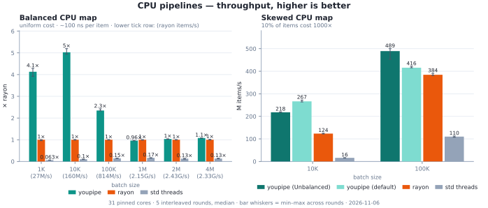
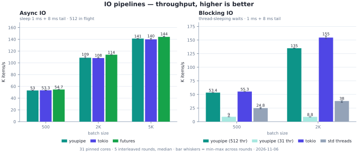
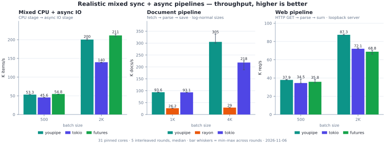

# youpipe

[English](https://github.com/lxl66566/youpipe/blob/main/README.md) | 简体中文

youpipe 是一个 Rust 并行 pipeline 库。数据从入口输入，各阶段依次串联，最后调用一次终端方法（`.collect()` / `.run()`）执行整条链并取得结果。三种引擎覆盖不同场景：

- `Pipe`：编译期融合的 CPU 链。`.map()`、`.filter()` 在编译期组合成单个泛型类型，执行时展开为一次调用，map 与 filter 之间不产生中间产物，`.collect()` 的结果按输入顺序写入缓冲区。闭包要求 `'static`，需要借用局部数据时用 `pipe_ref` 或 `scope`。
- `StreamPipe`：不同阶段由 bounded channel 连接，每个阶段使用独立 worker。同步阶段 / 异步阶段分别跑在 CPU / IO pool 上，并支持 Pipe 无法处理的 async IO、backpressure、fence、cancellation、一对多展开，输出默认按完成顺序（乱序）返回，也可使用 `.ordered()` 还原输入顺序。
  - 只有普通 `.stage()` 时退化为 Pipe，此时 channel 和 backpressure 被省略，输出即为输入顺序。
- `graph()`：运行期构建的 DAG，支持广播 fan-out、按入边轮询的 fan-in，CPU 节点和 IO 节点可在同一张图里混用。非广播节点走 move，无 `Clone` 约束；广播节点 clone。graph 输出一定是按完成顺序（乱序）。

调度器改编自 rayon-core。每个 worker 持有 `st3` 的 LIFO 双端队列，空闲 worker 从队列另一端窃取任务，均衡与不均衡负载都适用。`scope()` 支持借用栈上局部数据的非 `'static` 闭包。

## 快速上手

添加依赖：`cargo add youpipe`

`items.pipe()` 是 `pipe(items)` 的语法糖。

对于 rayon 的 `data.par_iter().map(|&x| x * 2).collect()` 这种最简单的用法（单轮 CPU 并行），可以直接改写为下方示例，即可获得免费的少量性能提升：

```rust
use youpipe::prelude::*;
let r: Vec<i32> = data.pipe_ref().map(|&x| x * 2).collect();  // par_iter 改为 pipe_ref 即可
```

其他引擎详解：

```rust
use youpipe::prelude::*;

// fused CPU 链：三步组合成单个泛型类型，无中间 Vec
let r: Vec<i32> = (0..1000).pipe()
    .map(|x| x + 1)
    .filter(|x: &i32| x % 2 == 0)
    .map(|x| x * 10)
    .collect();

// 聚合终端：同样走 fused 路径，不分配输出 Vec
let s: i64 = (0..1000).pipe().map(|x| x + 1).sum();

// 同步阶段与异步 IO 阶段分别在各自的线程池上重叠执行
let r: Vec<u64> = (0..1000).stream()
    .stage(|x: u64| x + 1)
    .stage_async(|x: u64| async move { fetch(x).await })
    .run();

// 运行期 DAG：广播到两个分支，再汇聚到一个节点
let mut g = youpipe::graph();
let src = g.source_broadcast("load", 0..1000u64);
let a = g.node("hash", |x: u64| x * 2);
let b = g.node_async("meta", |x: u64| async move { fetch(x).await });
let join = g.node("join", |x: u64| x);
let out = g.sink_collect("out");
g.edge(src, a).edge(src, b).edge(a, join).edge(b, join).edge(join, out);
let union: Vec<u64> = g.run_collect(out);
```

完整文档见 [lxl66566.github.io/youpipe](https://lxl66566.github.io/youpipe/)：

- [用户指南](https://lxl66566.github.io/youpipe/guide/getting-started.html)：fused 链、stream 链、DAG、借用数据、错误处理
- [性能调优](https://lxl66566.github.io/youpipe/advanced/choosing-engine.html)：引擎选择、负载提示、线程池、逐阶段参数，对于已知 workload 的情况下比较有帮助
- [Benchmark 与方法论](https://lxl66566.github.io/youpipe/dev/benchmarks.html)：库间对比与测量方法
- [开发者指南](https://lxl66566.github.io/youpipe/dev/design.html)：调度器、通道、验证（miri/loom）

## 性能

对比对象为 rayon、tokio、`futures::stream` 与手写 `std::thread` pipeline，覆盖七类负载：均衡与倾斜的 CPU 计算、异步与阻塞 IO、同步加异步混合，以及两个真实的三阶段 pipeline，其中一个走本地 mock server 上的 HTTP。

youpipe 在各类负载下均处于前列。CPU pipeline 在 1K–100K 元素区间快于 rayon，最高约 5 倍，1M 元素时两者持平，此时受内存带宽限制。真实三阶段 pipeline 比手写 tokio 通道代码快最多 28%。纯异步 IO 与 futures 相差几个百分点。

<p align="center">
  
</p>
<p align="center">
  
</p>
<p align="center">
  
</p>

总耗时低于 ~10 µs 或单元素低于 ~100 ns 时不建议使用 youpipe，并行调度的固定开销无法摊薄，顺序的 `iter().map().collect()` 更快。链上只有异步 IO、没有 CPU 阶段时，直接用 tokio 或 futures 更合适。

## Fuzz

crates/youpipe-fuzz 使用 cargo-fuzz 做覆盖率引导的模糊测试：

```sh
cargo fuzz run --fuzz-dir crates/youpipe-fuzz pipeline -- -max_total_time=60
```

共四个 target：`pipeline`（fused）、`stream`、`channel`、`reorder`。每个 target 都与串行参考模型比对结果。Windows 上的注意事项与已知问题见[验证指南](https://lxl66566.github.io/youpipe/dev/testing.html)。

## 第三方声明

`crates/youpipe/src/pool/` 中的调度器改编自 [rayon-core](https://github.com/rayon-rs/rayon)。
