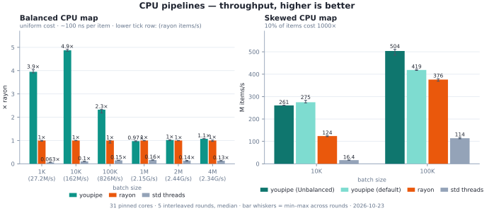
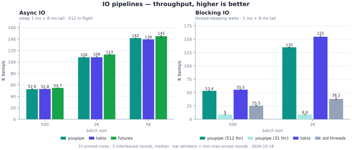
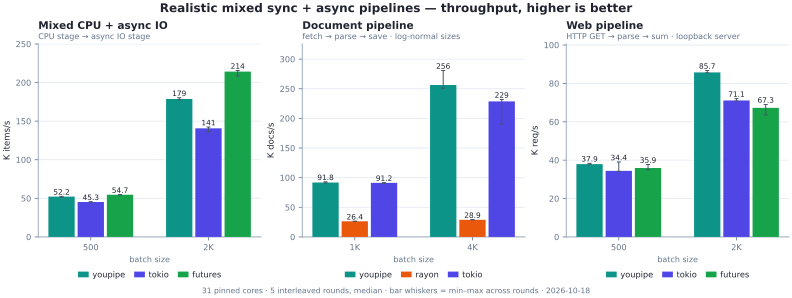

# Cross-library Comparison and Counters

## Horizontal cross-library comparison (2026-09)

`crates/youpipe/benches/horizontal.rs` answers the "what should I pick for my workload?" question across the ecosystem, youpipe, rayon, tokio, `futures::stream`, and hand-written `std::thread` baselines, over seven representative scenarios, and exports JSON that `perf/plot-horizontal.py` renders into the published SVG charts (the repo README plus the charts below; matplotlib via `uv run`; throughput, higher is better, min–max whiskers on the bar panels). The source data for the published charts is committed at `perf/horizontal/results.json`.

```sh
cargo bench -p youpipe --bench horizontal -- --rounds 5  # ~5 min incl. build
uv run perf/plot-horizontal.py                     # results.json → docs/src/assets/*.svg
```

### Charts

Throughput, higher is better; bar-chart whiskers span the five interleaved rounds. The balanced-CPU panel is drawn as × rayon on a linear axis: its absolute values span three decades across the batch sweep (1.8 → 2070 M items/s), and on the previous log-scale line chart the 4–5× youpipe advantage read as near-parity. Rayon's absolute throughput at each batch size rides as a second line under the batch-size tick labels, so any bar's absolute value is ratio × that number.







### Methodology

- Interleaved rounds, ABCABC rather than AABBCC. Every round runs every (scenario, batch, library) once, and odd rounds reverse the library order to cancel position bias. Verdicts are the median across rounds, the same drift-cancelling logic as `perf/bench-suite`, applied inside a single process (one tokio runtime + one `TokioPool` handle shared by everything; per-iteration runtime construction would dominate small batches).
- Per-iteration timing, setup excluded. Each job times only the workload (`Instant` around the run). CPU scenarios borrow the input on both sides: youpipe `pipe_ref(&data)` vs rayon `data.par_iter()` vs chunked borrows, each library's idiomatic call over the same warm slice, nothing cloned or freed inside the timed region. (History: before `pipe_ref` existed, the owned `pipe(v)` rows consumed a fresh cache-warmed clone and freed it in-region, and rayon was given an `into_par_iter` twin to match, a four-caliber tangle whose lesson, that fresh-clone/free cycles are worth ~35 % at 1M, lives on in the criterion benches in [sync-fused.md](sync-fused.md).) Results are black-boxed so LLVM cannot DCE the map chains.
- Simulated IO never touches the disk. Async waits use `tokio::time::sleep`, blocking waits `thread::sleep` (1 ms / 8 ms tail). The realistic web scenario speaks HTTP/1.1 over a loopback Unix-socket mock server with server-side latency control. UDS rather than TCP, because short-lived TCP connections pile up tens of thousands of client-side TIME_WAIT sockets across rounds and eventually exhaust the ephemeral port range, while UDS has no TIME_WAIT.
- In-flight caps must be aligned within a scenario. This one silently flipped two verdicts by ~2× in the first draft: youpipe's `io_concurrency` (256/512) capped concurrent IO while the tokio baseline spawned one task per item (effectively unbounded). With the cap left low, the doc pipeline scored youpipe 35 ms vs tokio 17 ms; raising youpipe to 4096 (above the largest batch, i.e. unbounded like spawn-per-item) reversed it to 14 ms vs 17 ms, and the original gap was queueing behind the concurrency cap rather than framework overhead. Rule: `io_async` compares the finite-cap regime (all three at 512), `mixed/real_doc/real_web` compare the unbounded regime (all three effectively unlimited). Fairness is a property of the scenario, not of each library's default.
- Input lifecycle must be uniform within a CPU scenario (2026-09 fix, superseded by `pipe_ref`): comparing an owned-input call against a borrowing one measures the input lifecycle rather than the engine, since the freeing side pays the clone's cache thrash right before the clock starts, an asymmetry worth ~35 % at 1M. The fix is structural now: both sides borrow the same warm slice (`pipe_ref` vs `par_iter`), which also collapsed the 1M round-to-round drift from ±25 % (fresh 8 MB clone + in-region free) to a few percent.
- Machine: 32-core AMD (Zen) Linux, bench pinned to cores 1–31 (`taskset -c 1-31`, core 0 left to OS/IRQ housekeeping), 5 rounds × 700 ms measurement, ~2–8 % cross-round spread on most cells.

### Results (median ms per iteration, 5 interleaved rounds; 2026-10-18 rerun on the 0.6.1 tip)

| Scenario | n | Best | Runner-up | Rest |
| --- | --- | --- | --- | --- |
| cpu_balanced | 1K | youpipe 0.009 | rayon 0.037 | std threads 0.547 |
| cpu_balanced | 10K | youpipe 0.013 | rayon 0.062 | std threads 0.570 |
| cpu_balanced | 100K | youpipe 0.053 | rayon 0.123 | std threads 0.795 |
| cpu_balanced | 1M | rayon 0.469 | youpipe 0.486 | std threads 2.834 |
| cpu_balanced | 2M | youpipe 0.803 | rayon 0.829 | std threads 6.514 |
| cpu_balanced | 4M | youpipe 1.574 | rayon 1.692 | std threads 12.706 |
| cpu_unbalanced | 10K | youpipe (default) 0.037 | youpipe (Unbalanced) 0.038 | rayon 0.080, std threads 0.573 |
| cpu_unbalanced | 100K | youpipe (Unbalanced) 0.200 | youpipe (default) 0.244 | rayon 0.269, std threads 0.858 |
| io_async | 500 | futures 9.140 | tokio 9.465 | youpipe 9.506 |
| io_async | 2K | futures 17.695 | tokio 18.459 | youpipe 18.500 |
| io_async | 5K | futures 34.479 | youpipe 35.266 | tokio 35.843 |
| io_blocking | 500 | tokio 9.005 | youpipe (512 thr) 9.370 | std threads 19.595, youpipe (31 thr) 55.793 |
| io_blocking | 2K | tokio 12.917 | youpipe (512 thr) 14.826 | std threads 52.328, youpipe (31 thr) 226.964 |
| mixed_cpu_io | 500 | futures 9.140 | youpipe 9.570 | tokio 11.037 |
| mixed_cpu_io | 2K | futures 9.339 | youpipe 11.191 | tokio 14.215 |
| real_doc | 1K | youpipe 10.895 | tokio 10.968 | rayon 37.895 |
| real_doc | 4K | youpipe 15.606 | tokio 17.498 | rayon 138.245 |
| real_web | 500 | youpipe 13.177 | futures 13.923 | tokio 14.522 |
| real_web | 2K | youpipe 23.332 | tokio 28.120 | futures 29.732 |

### Reading the results

- Balanced CPU (`pipe_ref` vs `par_iter`, both borrowing warm data): youpipe leads at 1K–100K by −57…−79 % (0.009 vs 0.037 ms @ 1K) and holds the memory-bound 2M/4M regime (−3 % @ 2M, −7 % @ 4M); @1M rayon edges ahead by +4 % in this rerun. Session note: rayon's anchor rows measured 6–14 % faster than the 2026-10-06 session (readback rows −17…−20 %), reproduced across three runs the same day, so it is a stable same-binary/session-level layout drift on the shared bench binary rather than youpipe-side movement (youpipe rows reproduced within ±2 %, and the 1M flip sits inside that rayon drift). The ≥2M regime is memory-bound (≥ 32 MB of R+W buffer traffic, outside the cache-resident range); the 2026-09-25 attributions in [attribution.md](attribution.md) pinned the then-gap on plain output stores' read-for-ownership + L3 pollution (non-temporal leaf stores, `YOUPIPE_NT_STORE`, closed and reversed it: 2M 0.82 vs rayon 0.83 ms, 4M 1.57 vs 1.68 ms) plus a secondary worker park/wake occupancy loss (~1–4 pt, causal via the spin-rounds knob). In every rerun since, the default configuration holds 2M/4M ahead; wall clocks are not comparable across sessions, but the ordering matches what the NT-store attribution predicted. Before the `num_cpus` cache (2026-09-05), rayon won 1K and 1M; the 1K loss was ~50 µs of cgroup-reading `available_parallelism` syscalls per run, not scheduling overhead. Equal-chunk hand-threading is 6–50× behind everywhere: 31 spawns per call, no stealing.
- Skewed CPU: `Workload::Unbalanced` + work stealing beats rayon at both sizes (0.038 vs 0.080 @ 10K, dead even with the default workload there; 0.200 vs 0.269 @ 100K), while static chunking is ~4–15× behind, stranding the 10 % heavy items in whichever chunks they landed in.
- Async IO is a near-tie, the spreads overlap. youpipe multiplexes over the same tokio runtime: within ~2 % of tokio at every size (ahead at 5K as channel throughput stops mattering) and 2–5 % behind `futures::stream`, the lightest async combinator stack. futures' mixed_cpu_io lead has the same cause: it runs the CPU stage inline on runtime workers. That is fine at 100 ns/item CPU, and the reason youpipe exists is everything it cannot do there: fences, cancellation, ordered output, dedicated CPU-pool isolation, and backpressure across stages rather than futures.
- Blocking IO is a configuration story: correctly oversubscribed, youpipe (512 thr) tracks tokio `spawn_blocking` within 4–15 % (the same 512-thread shape); at the default pool the waits serialize (227 ms @ 2K). The default-pool row is labelled `youpipe (N thr)` with N following the process affinity mask (31 under `taskset -c 1-31`). The chart keeps that failure visible on purpose: blocking stages must size the pool, not the framework.
- Realistic pipelines are where the streaming engine pays off: 3-stage sync+async chains are a near-tie with hand-written tokio channel plumbing at the small batch (real_doc 1K, ±1 %) and pull ahead ~11 % at the larger batches (fewer tasks, pooled scheduling, mixed-mode channels); rayon loses ~9× once IO blocks its workers.

## Perf-event counter measurement (`crates/youpipe-bench`)

`crates/youpipe-bench` (the opt-in lab-bench crate) runs the same bench code under Linux perf hardware counters (instructions / cycles / ref-cycles / cache-misses / …) instead of wall time, via the workspace's `youpipe-criterion-perf-counters` crate, a maintained fork of criterion-perf-events re-targeted at criterion 0.8 and extended with process-wide per-thread counters (upstream counts the main thread only, which for a pool library measures the coordinator and misses the workers). Threads that spawn and exit inside one measurement window are invisible, so channel benches cannot use it; plain `b.iter` only, since `BatchSize::PerIteration` windows multiply the per-window `4 × n_threads` counter syscalls by the iteration count and inflate fast benches.

```sh
cargo bench -p youpipe-bench --bench perf_events
PERF_EVENT=ref-cycles cargo bench -p youpipe-bench --bench perf_events
crates/youpipe-bench/run-drift-exp.sh          # N runs per event + drift summary table
```

Drift experiment (2026-09, 3 runs × 20 samples per kind, taskset 1-31), cross-run CV of run means over criterion's within-run CV:

| kind         | sequential 100K | youpipe cpu_heavy 100K | rayon cpu_heavy 100K | youpipe light 10K | rayon light 10K |
| ------------ | --------------- | ---------------------- | -------------------- | ----------------- | --------------- |
| walltime     | 0.13 %          | 0.47 %                 | 1.20 %               | 0.96 %            | 1.39 %          |
| instructions | **0.00 %**      | 0.79 %                 | 3.32 %               | 1.02 %            | 1.46 %          |
| cycles       | 0.03 %          | 1.24 %                 | 0.78 %               | 1.72 %            | 1.32 %          |
| ref-cycles   | 0.06 %          | 0.61 %                 | 1.58 %               | 3.87 %            | 0.87 %          |
| cache-misses | 20 % (≈200)     | 0.76 %                 | 0.61 %               | 0.73 %            | 0.48 %          |

Verdict:

- Deterministic instruction streams reproduce exactly (CV 0.00 % vs walltime 0.13 %), so a counter run is the cheapest "this change should touch nothing" check.
- Pool-bench drift is scheduling, not measurement: counters do not replace the interleaved-A/B methodology for throughput verdicts (rayon cpu_heavy instructions CV 3.3 % > walltime 1.2 %).
- Their payoff is work metrics wall time cannot express: instr/elem (cpu_heavy/100K: youpipe 120.5 vs rayon 136.6) and cycles/elem (youpipe 82, IPC 1.47, vs rayon 179, IPC 0.76); cache-misses reproduces at 0.5–0.8 % CV for real-traffic benches, a stable memory-behavior signal.
- Counter traps: cycles track wall time under frequency boost (stable here only because the governor pins frequency); cache-misses is meaningless when the absolute count is tiny; no counter is uniformly most stable (ref-cycles was worst for youpipe lightweight).

## Deterministic instruction counts (`crates/youpipe-gungraun`)

`crates/youpipe-gungraun` counts executed instructions under the Valgrind simulator (gungraun, the iai-callgrind successor) instead of sampling hardware counters, one run per benchmark, no clock, no statistics. Where the perf-event counter rows above still show 0.5–3 % cross-run CV on pool benches (scheduling leaks into even instruction counters on a real machine), the valgrind simulator's serialized scheduler removes that source entirely:

| shape | worst run-to-run Ir drift |
| --- | --- |
| youpipe channel rows (MPMC / MPSC ping-pong) | **0** — exact to the instruction |
| crossbeam channel row | **0** |
| std `sync_channel` row | ±0.04 % |
| fused `pipe` rows | 0 .. 0.003 % |
| rayon rows | ±0.06 % (timer-based idle sleeps) |
| `stream` rows | ±0.02 % |

Methodology essentials (full details in the crate's Readme):

- Count-all-threads caliber. gungraun's default per-function Callgrind toggle is per-thread state, so pool workers never enter the bench function and are invisible (measured: a 100K `pipe().collect()` counted only ~26 kIr of driver dispatch). The benches therefore run `EntryPoint::None` + `--collect-atstart=yes` and report process totals; every row of a group executes identical setup (`both_pools()` spawns a 4-worker youpipe pool and a 4-worker rayon pool even where a row uses neither) so the fixed offset cancels in `compare_by_id` deltas. Read deltas, not absolutes.
- Pinned 4-worker pools on both sides: default pools size to `available_parallelism()`, which would make counts host-dependent. The pinned pools still exercise the full dispatch/steal/wake surface.
- No async stages: tokio timers make counts time-dependent.
- Regression gating: `--save-baseline=main` / `--baseline=main --callgrind-limits='ir=2%'` exits 3 on regression. With the drift above, 2 % is comfortably tight and one run suffices (vs 3–5 interleaved criterion rounds for the same confidence).

First readings (process totals, deltas are the signal): cpu_heavy 1K, youpipe +8.7 % Ir vs rayon (the known fixed dispatch cost); cpu_heavy 100K, youpipe −2.3 %; light 100K, youpipe −8 % vs rayon and +21 % vs sequential; `stream` single-stage pass-through +3 % vs sequential at 10K.

```sh
cargo bench -p youpipe-gungraun            # ~1 min, all three bench files
cargo bench -p youpipe-gungraun -- --save-baseline=main
```

Worktree pitfall: in a linked worktree the base commit cannot be checked out by branch name (`git switch main` fails, the branch is held by the main checkout). Detach instead (`git switch --detach <sha>`), save the baseline, then switch back to the branch under test for the comparison (2026-10-20).

## Lab bench crate layout (`crates/youpipe-bench`)

The four former standalone bench crates were consolidated (2026-10) into one opt-in lab crate, `crates/youpipe-bench`: `--bench perf_events` (the perf-counter criterion bench above), `--bin file-encrypt` (real-disk mixed CPU/IO, recorded results in `results-file-encrypt.txt`), and `--bin hotpath-profile --features hotpath` (the hotpath driver). The fourth (`pipeline-bench`, simulated-IO 5-strategy document pipeline) was deleted rather than merged: its scenario already lived on as the `real_doc` row of `benches/horizontal` (interleaved rounds, stricter methodology), and its "youpipe all-sync 3 stages" row is moot since pure-sync `stream` chains now fuse onto the fused core.
